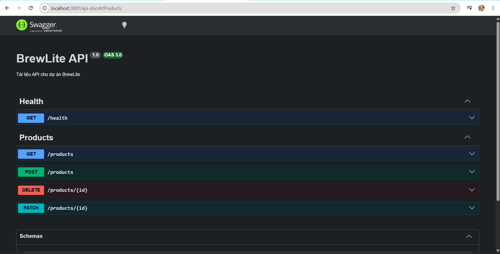

# BrewLite – Ứng dụng đặt cà phê không dùng tiền mặt

Web app mobile-first/PWA cho phép khách hàng xem menu, chọn size/topping, quản lý giỏ hàng, đặt đơn, thanh toán mô phỏng (Ví/Thẻ) và theo dõi đơn hàng. Service worker hỗ trợ duyệt menu đã cache khi offline; checkout cần kết nối mạng.

> Môn Công nghệ Phần mềm – Assignment 2 – Nhóm 6.

## Liên kết nhanh

| Mục | Liên kết |
|:--|:--|
| Frontend (URL nhóm cung cấp) | [https://brew-lite2-17cf.vercel.app/](https://brew-lite2-17cf.vercel.app/) — HTTP 200 trong lần kiểm tra 2026-11-15 |
| API (URL nhóm cung cấp) | [https://brew-lite2-backend.onrender.com](https://brew-lite2-backend.onrender.com) — health/products timeout ở lần kiểm tra gần nhất; chưa xác nhận healthy |
| Health check | [https://brew-lite2-backend.onrender.com/health](https://brew-lite2-backend.onrender.com/health) — timeout trong lần kiểm tra 2026-11-15 |
| Video demo | [Bản demo checkout local (WebM)](docs/evidence/brewlite-checkout-demo.webm) — API dùng test double, không phải production |
| Release notes | `docs/release-notes.md` |
| Sprint retrospective | `docs/sprint-retrospective.md` — dự kiến 2026-11-16; pre-read của nhóm, cần xác nhận sau buổi họp |

## Công nghệ

| Thành phần | Công nghệ |
|:--|:--|
| Frontend | Next.js (mobile-first/PWA, hỗ trợ menu đã cache khi offline), production trên Vercel |
| Backend | NestJS, production trên Render |
| Cơ sở dữ liệu | PostgreSQL (Render managed production; Compose local/testing) |
| Đóng gói | Docker, Docker Compose (local/testing) |
| CI/CD | GitHub Actions → Render API + Vercel CLI |

## Luồng nghiệp vụ

Xem menu → Chọn size/topping → Giỏ hàng → Đặt đơn → Thanh toán (mock) → Theo dõi đơn.

## Cấu trúc repository

```
brewlite/
├── apps/
│   ├── web/                  # Next.js
│   └── api/                  # NestJS
├── docs/
│   ├── requirements/         # context-and-scope, srs, uc-checkout-spec
│   ├── diagrams/             # UML sources/exports; README records export status
│   ├── architecture/         # overview.md, adr/
│   ├── traceability-matrix.md
│   ├── deployment.md
│   └── production.env.example  # legacy Ubuntu/Compose template; retired
├── tests/                    # index cho API tests và browser E2E
├── .github/workflows/        # ci.yml, cd.yml
├── docker-compose.yml
├── .env.example
└── README.md
```

## Yêu cầu môi trường

- Node.js >= 20 và npm (hoặc pnpm)
- Docker và Docker Compose v2
- Git

## Chạy local

### Cách 1: Docker Compose (khuyến nghị)

```bash
git clone https://github.com/nguyentriet2k69-lang/brew-lite2.git
cd brew-lite2
cp .env.example .env
docker compose up --build --wait
```

PowerShell equivalent for the environment file:

```powershell
Copy-Item .env.example .env
docker compose up --build --wait
```

Sau khi chạy:

| Dịch vụ | Địa chỉ |
|:--|:--|
| Web | http://localhost:3000 |
| API | http://localhost:3001 |
| Health | http://localhost:3001/health |

Compose chờ PostgreSQL healthy rồi áp dụng migration và seed idempotent trước khi mở API. PostgreSQL chỉ bind vào loopback; cấu hình local này không dùng làm cấu hình production.

Nếu host đã dùng cổng 5432, đổi cổng bind local mà không đổi kết nối nội bộ Compose:

```powershell
$env:POSTGRES_HOST_PORT = '5434'
docker compose up --build --wait
```

### Cách 2: Chạy từng phần

```bash
# Database
docker compose up -d db

# Backend
cd apps/api
npm install
npm run migration:run
npm run seed
npm run start:dev

# Frontend (terminal khác)
cd apps/web
npm install
npm run dev
```

## Biến môi trường

Chỉ commit `.env.example`; **không** commit `.env` hoặc secret thật.

| Biến | Mô tả | Ví dụ |
|:--|:--|:--|
| `DATABASE_URL` | Chuỗi kết nối PostgreSQL trong Compose | Xem `.env.example` |
| `POSTGRES_PASSWORD` | Mật khẩu DB local, đồng bộ với `DATABASE_URL` | Placeholder local trong `.env.example` |
| `JWT_SECRET` | Khóa ký JWT, tối thiểu 32 bytes UTF-8 | Tạo giá trị riêng, không dùng placeholder production |
| `JWT_EXPIRES_IN` | Thời hạn token | `1d` |
| `NEXT_PUBLIC_API_URL` | URL API mà browser truy cập được; production cần HTTPS public domain | `http://localhost:3001` |
| `API_HOST_PORT`, `WEB_HOST_PORT` | Cổng host chỉ bind loopback | `3001`, `3000` |

## API chính

| Method | Endpoint | Mô tả | Xác thực |
|:--|:--|:--|:--|
| GET | `/products` | Danh sách sản phẩm | Không |
| GET | `/products/:id` | Chi tiết sản phẩm | Không |
| GET | `/pricing/options` | Danh sách size/topping và phụ thu | Không |
| POST | `/auth/register` | Đăng ký | Không |
| POST | `/auth/login` | Đăng nhập, trả JWT | Không |
| POST | `/orders` | Tạo đơn (PENDING), cần header `Idempotency-Key` | JWT |
| GET | `/orders/:id` | Chi tiết đơn của người dùng hiện tại | JWT |
| GET | `/orders/me` | Lịch sử đơn của tôi | JWT |
| POST | `/payments` | Thanh toán mock, cần `Idempotency-Key` riêng | JWT |
| GET | `/payments/:id` | Đọc trạng thái payment để reconcile/poll | JWT |
| GET | `/health` | Kiểm tra sức khỏe hệ thống | Không |

## Kiểm thử

```powershell
# Run from repository root
docker compose -p brew-lite2-test -f docker-compose.test.yml up -d --wait

# Unit + PostgreSQL spec (TEST_DATABASE_URL cần cho các integration spec)
$env:TEST_DATABASE_URL = 'postgresql://brewlite_test@127.0.0.1:5433/brewlite_test'
Push-Location apps\api
npm run test -- --runInBand

# PostgreSQL integration test (lệnh suite riêng)
npm run test:integration

# API E2E (đăng ký/đăng nhập -> đặt đơn -> xác nhận thanh toán)
npm run test:e2e
Remove-Item Env:TEST_DATABASE_URL
Pop-Location
docker compose -p brew-lite2-test -f docker-compose.test.yml down

# Lint và build
Push-Location apps\api
npm run lint
npm run build
Pop-Location
Push-Location apps\web
$env:NEXT_PUBLIC_API_URL = 'http://127.0.0.1:4174'
npm run lint
npm run build
npx playwright install chromium # chạy một lần trên máy mới
npm run test:e2e
Remove-Item Env:NEXT_PUBLIC_API_URL
Pop-Location
```

Test API nằm trong `apps/api/src/**/*.spec.ts` và `apps/api/test/`; Playwright browser E2E chạy từ `apps/web/e2e/` với API test double cô lập. Thư mục `tests/` ở root là test index. Xem [test index](tests/README.md) và [ma trận truy vết](docs/traceability-matrix.md).

## CI/CD

- **CI** (`.github/workflows/ci.yml`): chạy khi mở/cập nhật PR: Install → Lint → Unit + PostgreSQL integration/API E2E → Build → Chromium browser E2E. Cần bật branch protection và required checks `API`, `Web` trong GitHub Settings.
- **CD** (`.github/workflows/cd.yml`): sau verify, deploy đúng commit SHA lên Render, chờ live + API smoke, deploy web production qua Vercel CLI, rồi kiểm tra HTTPS và CORS preflight. Smoke fail sẽ rollback Vercel (nếu đã deploy) và Render API về deployment trước. Cần cấu hình GitHub Environment variables/secrets và provider services theo [runbook](docs/deployment.md); workflow production chưa được chạy.
- Production architecture đã thống nhất là Vercel + Render; Compose chỉ dùng local/testing. Lần kiểm tra gần nhất: web root HTTP 200, manifest/icons trả 404; API health/products timeout và chưa xác nhận healthy. GitHub Actions API hiện chưa liệt kê workflow trên nhánh mặc định; các thay đổi đang chờ review/merge nên chưa có CI/CD production run. Chi tiết ở [release notes](docs/release-notes.md).

## Triển khai và Rollback

Chi tiết và cấu hình provider: `docs/deployment.md`. Nền tảng production: Vercel (web), Render (API + PostgreSQL managed). `docs/production.env.example`, `docker-compose.prod.yml`, `Caddyfile` và `scripts/*production.sh` là cấu hình Ubuntu cũ đã retire; không dùng để deploy.

**Deploy và rollback:**

Deploy production tự động qua GitHub Actions sau khi cấu hình GitHub Environment `production`, Render service/database và Vercel project. Đặt `NEXT_PUBLIC_API_URL` trên Vercel và `CORS_ORIGIN` trên Render API theo đúng hai origin. Không đưa secrets vào repo hoặc chat.

**Rollback (tóm tắt):**
1. Tự động: CD rollback web bằng Vercel CLI và API bằng Render API nếu rollout/smoke thất bại.
2. Thủ công: dùng `vercel rollback` cho web hoặc mục rollback trong Render Deploys cho API; hướng dẫn chi tiết ở [deployment runbook](docs/deployment.md).
3. Rollback ứng dụng không đảo migration/schema hoặc khôi phục PostgreSQL. Migration phải backward-compatible; backup/restore phụ thuộc plan và quy trình của Render.

## Tài liệu

| Tài liệu | Đường dẫn |
|:--|:--|
| Bối cảnh, stakeholder, phạm vi | `docs/requirements/context-and-scope.md` |
| SRS rút gọn (FR/NFR/MoSCoW/AC) | `docs/requirements/srs.md` |
| Đặc tả UC-05 | `docs/requirements/uc-checkout-spec.md` |
| Sơ đồ UML, deployment | `docs/diagrams/` |
| Kiến trúc và ADR | `docs/architecture/` |
| Ma trận truy vết | `docs/traceability-matrix.md` |

## Quy trình làm việc nhóm

- **Nhánh:** `main` là production; `develop` là nhánh tích hợp; dùng `feature/<issue>-<short-name>`, `fix/<issue>-<short-name>` hoặc `hotfix/<short-name>`. Không push trực tiếp vào `main`/`develop`.
- **Bảo vệ nhánh:** bật PR bắt buộc, ít nhất 1 approval không phải tác giả và yêu cầu cả hai status check `API` và `Web` trong `.github/workflows/ci.yml` trước khi merge; dismiss approval cũ khi có commit mới.
- **Commit:** Conventional Commits `type(scope): imperative summary`, ví dụ `feat(api): add product endpoint`. Type tối thiểu: `feat`, `fix`, `docs`, `test`, `refactor`, `ci`, `chore`; dùng `!`/`BREAKING CHANGE` khi không tương thích.
- **Pull request:** dùng `.github/pull_request_template.md`, liên kết issue, ghi lệnh kiểm thử và minh chứng; thêm ảnh nếu thay đổi UI.
- **Definition of Done:** acceptance criteria đạt; lint, unit/integration/E2E liên quan và build pass; migration/rollback an toàn; tài liệu và traceability cập nhật; không có secret; PR đã review và CI bắt buộc xanh.

## Nhóm thực hiện

| TV | Họ tên | Vai trò |
|:--|:--|:--|
| TV1 | Nguyễn Minh Triết | Requirements Owner |
| TV2 | Nguyễn Tiến Anh | Modeling Owner |
| TV3 | Bùi Hải Dương | Architecture Owner |
| TV4 | Nguyễn Trọng Nguyễn | Frontend Owner |
| TV5 | Tất Hòa Tường | Backend Owner |
| TV6 | Vũ Tiến Thịnh | DevOps & Quality Owner |

## Checklist nộp bài

- [x] Requirements + SRS
- [x] Use-case diagram + đặc tả UC-05
- [x] Activity diagram (hết hàng, chưa đăng nhập, payment success/failure/unknown)
- [x] Sequence diagram (JWT, transaction, alt, separate idempotency keys)
- [x] Class diagram domain
- [x] Kiến trúc + ADR (ADR-005 được ADR-006 thay thế)
- [x] Deployment diagram và production platform Vercel + Render được ghi tài liệu
- [x] Repository đúng cấu trúc + tài liệu
- [x] MVP Sprint 1 (menu chạy được)
- [x] CI + minh chứng success/fail (local; xem `docs/evidence/`)
- [x] MVP Sprint 2 flow UI đã nối menu/cart/auth/order/payment/history; browser smoke thủ công pass
- [x] API unit (126/126) + PostgreSQL integration (9/9) + API E2E (2/2) + browser E2E (2/2 local)
- [x] `docker compose up --build --wait` local; API/Web/DB healthy và HTTP smoke pass
- [x] Migration/seed trên PostgreSQL local Compose + `/health`
- [x] CD workflow/configuration cho Vercel + Render; deployment live chưa được xác minh
- [x] URL frontend HTTPS reachable (HTTP 200); manifest/icons hiện trả 404
- [x] URL API HTTPS provided by the team
- [ ] Production API health/CORS/checkout smoke
- [ ] Render PostgreSQL access, backup/restore và production migration đã xác minh
- [x] Không thêm secret production vào repo; runtime secrets nằm ngoài Git
- [x] Release notes + README + rollback
- [x] Video demo checkout end-to-end (local, API test double; không có narration)
- [ ] Sprint Review + Retrospective
- [x] Ma trận truy vết phản ánh code/test hiện có và các gap còn lại
- [ ] Lịch sử Git rõ ràng + cấp quyền truy cập cho giảng viên
- [x] PWA manifest/icons + service worker cache shell/menu for offline browsing (checkout still requires network)
- [x] Manual viewport smoke ở 360/390/414 px; không tràn ngang
- [x] Automated browser E2E wired into CI/CD workflows (GitHub workflow execution still pending push)
- [x] Regenerated SVG previews for PlantUML sources
## Minh chứng (Evidence)

### 1. Giao diện MVP Sprint 1 (Menu)


### 2. Tài liệu API (Swagger)


### 3. Health Check


### 4. Video demo
[Xem/tải video checkout (WebM)](docs/evidence/brewlite-checkout-demo.webm) — bản quay local bằng Playwright, backend API test double.