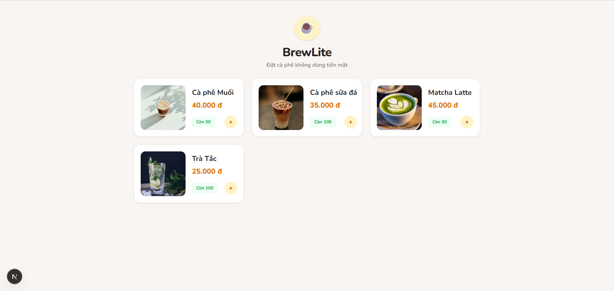

# BrewLite – Ứng dụng đặt cà phê không dùng tiền mặt

Web app mobile-first/PWA cho phép khách hàng xem menu, chọn size/topping, quản lý giỏ hàng, đặt đơn, thanh toán mô phỏng (Ví/Thẻ) và theo dõi đơn hàng.

> Môn Công nghệ Phần mềm – Assignment 2 – Nhóm 6.

## Liên kết nhanh

| Mục | Liên kết |
|:--|:--|
| Frontend (production, HTTPS) | Chưa deploy; cấu hình bằng `WEB_DOMAIN` |
| API (production) | Chưa deploy; cấu hình bằng `API_DOMAIN` |
| Health check | Sau deploy: `https://<API_DOMAIN>/health` |
| Video demo | `<TODO>` |
| Release notes | `docs/release-notes.md` |

## Công nghệ

| Thành phần | Công nghệ |
|:--|:--|
| Frontend | Next.js (mobile-first/PWA) |
| Backend | NestJS |
| Cơ sở dữ liệu | PostgreSQL |
| Đóng gói | Docker, Docker Compose |
| CI/CD | GitHub Actions |

## Luồng nghiệp vụ

Xem menu → Chọn size/topping → Giỏ hàng → Đặt đơn → Thanh toán (mock) → Theo dõi đơn.

## Cấu trúc repository

```
brewlite/
├── apps/
│   ├── web/                  # Next.js
│   └── api/                  # NestJS
├── docs/
│   ├── requirements/         # context-and-scope, srs, uc-checkout-spec
│   ├── diagrams/             # .puml + .svg (use-case, activity, sequence, class, deployment)
│   ├── architecture/         # overview.md, adr/
│   ├── traceability-matrix.md
│   ├── deployment.md
│   └── production.env.example
├── tests/                    # integration + E2E
├── .github/workflows/        # ci.yml, cd.yml
├── docker-compose.yml
├── .env.example
└── README.md
```

## Yêu cầu môi trường

- Node.js >= 20 và npm (hoặc pnpm)
- Docker và Docker Compose v2
- Git

## Chạy local

### Cách 1: Docker Compose (khuyến nghị)

```bash
git clone https://github.com/nguyentriet2k69-lang/brew-lite2.git
cd brew-lite2
cp .env.example .env          # đổi JWT_SECRET và mật khẩu local trước khi dùng
docker compose up --build --wait
```

Sau khi chạy:

| Dịch vụ | Địa chỉ |
|:--|:--|
| Web | http://localhost:3000 |
| API | http://localhost:3001 |
| Health | http://localhost:3001/health |

Compose chờ PostgreSQL healthy rồi áp dụng migration và seed idempotent trước khi mở API. PostgreSQL chỉ bind vào loopback; cấu hình local này không dùng làm cấu hình production.

### Cách 2: Chạy từng phần

```bash
# Database
docker compose up -d db

# Backend
cd apps/api
npm install
npm run migration:run
npm run seed
npm run start:dev

# Frontend (terminal khác)
cd apps/web
npm install
npm run dev
```

## Biến môi trường

Chỉ commit `.env.example`; **không** commit `.env` hoặc secret thật.

| Biến | Mô tả | Ví dụ |
|:--|:--|:--|
| `DATABASE_URL` | Chuỗi kết nối PostgreSQL trong Compose | Xem `.env.example` |
| `POSTGRES_PASSWORD` | Mật khẩu DB local, đồng bộ với `DATABASE_URL` | Placeholder local trong `.env.example` |
| `JWT_SECRET` | Khóa ký JWT, tối thiểu 32 bytes UTF-8 | Tạo giá trị riêng, không dùng placeholder production |
| `JWT_EXPIRES_IN` | Thời hạn token | `1d` |
| `NEXT_PUBLIC_API_URL` | URL API nội bộ dùng khi build Web trong Compose | `http://api:3001` |
| `API_HOST_PORT`, `WEB_HOST_PORT` | Cổng host chỉ bind loopback | `3001`, `3000` |

## API chính

| Method | Endpoint | Mô tả | Xác thực |
|:--|:--|:--|:--|
| GET | `/products` | Danh sách sản phẩm | Không |
| GET | `/products/:id` | Chi tiết sản phẩm | Không |
| POST | `/auth/register` | Đăng ký | Không |
| POST | `/auth/login` | Đăng nhập, trả JWT | Không |
| POST | `/orders` | Tạo đơn (PENDING) | JWT |
| POST | `/payments` | Thanh toán mock, header `Idempotency-Key` | JWT |
| GET | `/orders/me` | Lịch sử đơn của tôi | JWT |
| GET | `/health` | Kiểm tra sức khỏe hệ thống | Không |

## Kiểm thử

```powershell
# Run from repository root
docker compose -f docker-compose.test.yml up -d --wait

# Unit test
Push-Location apps\api
npm run test -- --runInBand

# PostgreSQL integration test (Compose test DB riêng)
$env:TEST_DATABASE_URL = 'postgresql://brewlite_test@127.0.0.1:5433/brewlite_test'
npm run test:integration

# E2E (menu -> đăng nhập -> đặt đơn -> xác nhận thanh toán)
npm run test:e2e
Remove-Item Env:TEST_DATABASE_URL
Pop-Location
docker compose -f docker-compose.test.yml down

# Lint và build
Push-Location apps\api
npm run lint
npm run build
Pop-Location
Push-Location apps\web
npm run lint
npm run build
Pop-Location
```

Ánh xạ yêu cầu – test: xem `docs/traceability-matrix.md`.

## CI/CD

- **CI** (`.github/workflows/ci.yml`): chạy khi mở/cập nhật PR: Install → Lint → Unit + PostgreSQL integration/E2E → Build. Cần bật branch protection và required checks `API`, `Web` trong GitHub Settings.
- **CD** (`.github/workflows/cd.yml`): push `main` hoặc tag `v*` chạy Verify → Build image → Push GHCR theo SHA/semantic version → Deploy Compose trên Ubuntu → HTTPS smoke test; lỗi smoke tự gọi rollback image.
- Chọn Ubuntu 24.04 theo [deployment runbook](docs/deployment.md). Workflow chưa chạy production vì chưa được cấp server, DNS và GitHub Environment secrets; không nhập secrets vào repo hoặc chat.

## Triển khai và Rollback

Chi tiết: `docs/deployment.md`; cấu hình mẫu production: `docs/production.env.example`. Nền tảng đã chọn: Ubuntu 24.04 + Docker Compose + Caddy.

**Rollback (tóm tắt):**
1. Tự động: CD phục hồi SHA ứng dụng trước khi rollout nếu deploy/server smoke fail; public smoke fail thì gọi `bash ./rollback-production.sh`.
2. Thủ công: chạy `bash ./rollback-production.sh` trên server trong `/opt/brewlite`; kiểm tra `/health`, `/products` và trang web.
3. Rollback image không đảo schema. Không chạy `migration:revert` trên dữ liệu production; dùng migration tương thích ngược hoặc quy trình backup/restore đã được duyệt.

## Tài liệu

| Tài liệu | Đường dẫn |
|:--|:--|
| Bối cảnh, stakeholder, phạm vi | `docs/requirements/context-and-scope.md` |
| SRS rút gọn (FR/NFR/MoSCoW/AC) | `docs/requirements/srs.md` |
| Đặc tả UC-05 | `docs/requirements/uc-checkout-spec.md` |
| Sơ đồ UML, deployment | `docs/diagrams/` |
| Kiến trúc và ADR | `docs/architecture/` |
| Ma trận truy vết | `docs/traceability-matrix.md` |

## Quy trình làm việc nhóm

- **Nhánh:** `main` là production; `develop` là nhánh tích hợp; dùng `feature/<issue>-<short-name>`, `fix/<issue>-<short-name>` hoặc `hotfix/<short-name>`. Không push trực tiếp vào `main`/`develop`.
- **Bảo vệ nhánh:** bật PR bắt buộc, ít nhất 1 approval không phải tác giả và yêu cầu cả hai status check `API` và `Web` trong `.github/workflows/ci.yml` trước khi merge; dismiss approval cũ khi có commit mới.
- **Commit:** Conventional Commits `type(scope): imperative summary`, ví dụ `feat(api): add product endpoint`. Type tối thiểu: `feat`, `fix`, `docs`, `test`, `refactor`, `ci`, `chore`; dùng `!`/`BREAKING CHANGE` khi không tương thích.
- **Pull request:** dùng `.github/pull_request_template.md`, liên kết issue, ghi lệnh kiểm thử và minh chứng; thêm ảnh nếu thay đổi UI.
- **Definition of Done:** acceptance criteria đạt; lint, unit/integration/E2E liên quan và build pass; migration/rollback an toàn; tài liệu và traceability cập nhật; không có secret; PR đã review và CI bắt buộc xanh.

## Nhóm thực hiện

| TV | Họ tên | Vai trò |
|:--|:--|:--|
| TV1 | `<TODO>` | Requirements Owner |
| TV2 | `<TODO>` | Modeling Owner |
| TV3 | `<TODO>` | Architecture Owner |
| TV4 | `<TODO>` | Frontend Owner |
| TV5 | `<TODO>` | Backend Owner |
| TV6 | `<TODO>` | DevOps & Quality Owner |

## Checklist nộp bài

- [ ] Requirements + SRS
- [ ] Use-case diagram + đặc tả UC-05
- [ ] Activity diagram (hết hàng, chưa đăng nhập, thanh toán thất bại)
- [ ] Sequence diagram (JWT, transaction, alt, Idempotency-Key)
- [ ] Class diagram domain
- [ ] Kiến trúc + ADR
- [ ] Deployment diagram/host thật được xác minh (đã chọn Ubuntu, còn chờ server)
- [ ] Repository đúng cấu trúc + tài liệu
- [ ] MVP Sprint 1 (menu chạy được)
- [x] CI + minh chứng success/fail (local; xem `docs/evidence/`)
- [ ] MVP Sprint 2 end-to-end
- [x] Unit + Integration (9/9 PostgreSQL) + ≥ 1 E2E
- [ ] `docker compose up` chạy được (Docker Engine local chưa khả dụng)
- [x] Migration/seed trên PostgreSQL thật + `/health`
- [x] CD workflow/configuration; cần host/secrets để xác minh live deploy
- [ ] URL frontend production HTTPS
- [ ] URL API + health check
- [x] Production Compose không publish database; cần xác minh firewall trên host
- [x] Không thêm secret production vào repo; runtime secrets nằm ngoài Git
- [x] Release notes + README + rollback
- [ ] Video demo end-to-end
- [ ] Sprint Review + Retrospective
- [ ] Ma trận truy vết đầy đủ
- [ ] Lịch sử Git rõ ràng + cấp quyền truy cập cho giảng viên
## Minh chứng (Evidence)

### 1. Giao diện MVP Sprint 1 (Menu)


### 2. Tài liệu API (Swagger)


### 3. Health Check
