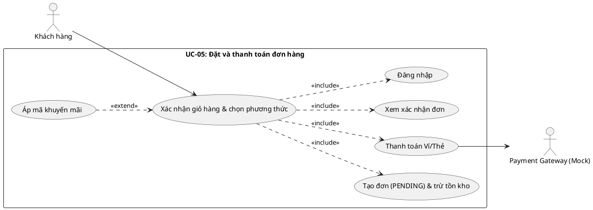

# Đặc tả Use-case UC-05: Đặt và thanh toán đơn hàng (Task 1.3)

## 1. Thông tin chung

| Mục | Nội dung |
|:--|:--|
| Mã / Tên | UC-05 – Đặt và thanh toán đơn hàng |
| Actor chính | Khách hàng (Customer) |
| Actor phụ | Payment Gateway (mock) |
| Mục tiêu | Khách chuyển giỏ hàng thành đơn hợp lệ và thanh toán không tiền mặt |
| Trigger | Khách bấm "Thanh toán" trong màn hình giỏ hàng |
| Yêu cầu liên quan | FR-03, FR-04, FR-05, FR-06, FR-08, FR-09, NFR-02, NFR-07 (FR-10 nếu hiện thực) |

## 2. Tiền điều kiện
1. Giỏ hàng có ít nhất 1 sản phẩm hợp lệ.
2. Khách đã đăng nhập (có JWT hợp lệ); nếu chưa, xem luồng thay thế A1.
3. Hệ thống và dịch vụ thanh toán mock đang hoạt động.

## 3. Hậu điều kiện
- **Thành công:** đơn ở trạng thái PAID, có mã đơn; tồn kho đã trừ; giỏ hàng được làm trống; có bản ghi Payment gắn với Idempotency-Key; hiển thị màn hình xác nhận.
- **Thất bại thanh toán:** đơn ở trạng thái PAYMENT_FAILED; giỏ hàng giữ nguyên; khách có thể thử lại.
- **Thất bại khác (hết hàng, dữ liệu sai):** không tạo đơn, không trừ tồn kho, giỏ hàng giữ nguyên.

## 4. Luồng chính (Main flow)
1. Khách bấm "Thanh toán" tại giỏ hàng; UI hiển thị tổng tiền và các phương thức (Ví điện tử / Thẻ ngân hàng).
2. Khách chọn phương thức và xác nhận.
3. UI sinh Idempotency-Key và gọi `POST /orders` kèm JWT và nội dung giỏ hàng.
4. API kiểm tra JWT và validate dữ liệu.
5. API mở transaction: kiểm tra tồn kho, tính lại giá phía server, tạo Order (PENDING) + OrderItem, trừ tồn kho, commit; trả mã đơn.
6. UI gọi `POST /payments` với mã đơn, phương thức và Idempotency-Key.
7. API gọi Payment Gateway (mock) để xử lý giao dịch.
8. Payment Gateway trả kết quả thành công.
9. API lưu Payment, chuyển đơn sang PAID.
10. UI hiển thị xác nhận: mã đơn, trạng thái PAID, thông báo tới quầy nhận đồ; giỏ hàng được xóa.

## 5. Luồng thay thế (Alternative flows)
- **A1 – Chưa đăng nhập (tại bước 1/3):** UI chuyển hướng tới đăng nhập/đăng ký (UC-04); sau khi đăng nhập quay lại giỏ hàng, giữ nội dung giỏ và tiếp tục từ bước 1.
- **A2 – Khách đổi phương thức/hủy (tại bước 2):** khách quay lại giỏ hàng; không tạo đơn.
- **A3 – Gửi lại yêu cầu thanh toán (retry/double-click):** API nhận cùng Idempotency-Key, trả lại kết quả đã có, không tạo giao dịch hay đơn thứ hai.
- **A4 – Áp mã khuyến mãi (nếu hiện thực, trước bước 3):** mã hợp lệ làm giảm tổng tiền; mã sai bị từ chối nhưng khách vẫn tiếp tục thanh toán không có mã.

## 6. Luồng ngoại lệ (Exception flows)
- **E1 – Sản phẩm hết hàng / không đủ tồn kho (bước 5):** transaction rollback; API trả lỗi; UI báo sản phẩm hết hàng và đề nghị chỉnh giỏ hàng; không tạo đơn.
- **E2 – Dữ liệu không hợp lệ (bước 4):** API trả 400 kèm chi tiết; UI hiển thị lỗi cạnh trường liên quan.
- **E3 – JWT thiếu/hết hạn (bước 4):** API trả 401; UI chuyển tới đăng nhập (như A1).
- **E4 – Thanh toán thất bại (bước 8):** Payment Gateway trả lỗi; API chuyển đơn sang PAYMENT_FAILED; UI báo lỗi, giữ giỏ hàng và cho phép thử lại hoặc đổi phương thức.
- **E5 – Payment Gateway không phản hồi/timeout (bước 7):** coi như thất bại thanh toán như E4; khách thử lại với cùng Idempotency-Key để tránh trùng giao dịch.
- **E6 – Lỗi hệ thống (DB/API):** API trả 5xx; transaction rollback; UI hiển thị lỗi chung và cho phép thử lại.

## 7. Hệ thống làm gì / không làm gì
**Làm:** xác thực người dùng, validate, tính giá phía server, tạo đơn và trừ tồn kho trong transaction, gọi cổng mock, bảo đảm idempotent, cập nhật trạng thái đơn, hiển thị xác nhận.
**Không làm:** thanh toán bằng tiền thật/cổng thật, hoàn tiền, giao hàng, xử lý pha chế (PREPARING/READY/COMPLETED thuộc phần mở rộng), quản trị cửa hàng.

## 8. Sơ đồ use-case phạm vi UC-05

## 9. Tiêu chí chấp nhận và gợi ý test
| Mã | Kịch bản | Kết quả mong đợi | Loại test |
|:--|:--|:--|:--|
| T-UC05-01 | Happy path: giỏ hợp lệ, đã đăng nhập, thanh toán thành công | Đơn PAID, hiển thị mã đơn, giỏ trống | E2E |
| T-UC05-02 | Chưa đăng nhập bấm Thanh toán | Chuyển tới đăng nhập, giỏ giữ nguyên | E2E/component |
| T-UC05-03 | Sản phẩm hết hàng | Không tạo đơn, báo lỗi, giỏ giữ nguyên | Integration |
| T-UC05-04 | Cổng mock trả lỗi | Đơn PAYMENT_FAILED, giỏ giữ nguyên, cho thử lại | Integration |
| T-UC05-05 | Gửi 2 lần cùng Idempotency-Key | Chỉ một Payment/đơn | Integration |
| T-UC05-06 | Hai yêu cầu đồng thời cho lượng tồn cuối | Chỉ một thành công | Integration |
| T-UC05-07 | Dữ liệu sai (qty ≤ 0) | 400, không tạo đơn | Unit/Integration |
| T-UC05-08 | Giá do client gửi bị sửa | Server tính lại, dùng giá đúng | Unit |
